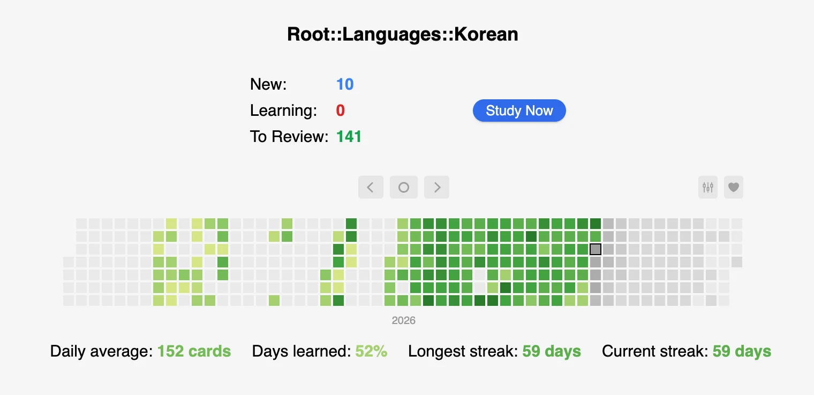

안녕하세요!

Well... I've considerably slowed down on my Korean learning; my [attempts to integrate grammar
lessons](/operation-k-2-habits) were not prosperous. Perhaps, trying to cover one lesson every single day---especially HTSK lesson---was not a very good idea.

I still think that comprehensible input is the core engine of learning a language. But I presume strong foundational grammatical knowledge weighs more when you are a beginner. It's often better to just read the technical rules underlying a certain particle, word, or structure rather than trying to guess how it works from the context. For instance, I don't think I could've properly understood irregulars without reading the [explanations](https://www.howtostudykorean.com/unit1/unit-1-lessons-9-16/lesson-12/) (although I still have some troubles with them even after the lesson).

But I'm pretty happy with my Anki streak! I've been reviewing the cards for almost 2 months without any skips and so far I have \~450 mature cards.

<figure>

<figcaption>My Anki [Heatmap](https://ankiweb.net/shared/info/1771074083)</figcaption>
</figure>

But I can't make something sensible from these words without knowing some grammar, so I'm back on grammar. I decided to start smaller by covering only two HTSK lessons per week. We'll see how it goes.

## Word of the week

I decided to play around with the format of Operation K and Claude suggested the "word of the week" idea!

This week's word is 푸르다 which is the dictionary form of the verb "to be blue/green". It's a pretty unique word that, as far as I can tell, doesn't have any commonly used alternatives in English, Russian, or Kazakh.

The word is used as *blue* in 푸른 하늘 (blue sky); as *green* in 푸른 숲 (green forest); as *blue* in 푸른 바다 (blue sea). So, generally, it's used as a color that you can observe in nature.

Then I've looked up on this topic and turns out it relates to a concept of [*grue*](https://en.wikipedia.org/wiki/Blue%E2%80%93green_distinction_in_language) which isn't unique to Korean; Chinese, Japanese, Vietnamese, and many other languages seem to have similar words.
